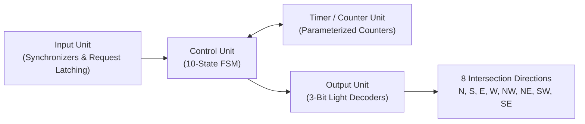
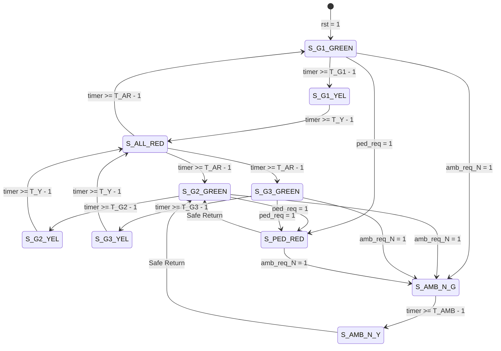

# Smart Traffic Light Controller Using Verilog HDL

<p align="center">
  
  
  
  
  
</p>

A synthesized and verified **Finite State Machine (FSM)** based **Smart Traffic Light Controller** implemented in **Verilog HDL**. The controller orchestrates traffic across eight multi-directional lanes (North, South, East, West, NW, NE, SW, SE) at a complex urban junction, featuring real-time priority preemption for emergency vehicles (Ambulance North priority) and pedestrian safety halts (All-Red crossing).

---

## Authors & Institutional Affiliation

- **Aparajith Krishna S** — [GitHub](https://github.com/AparajithKrishna43) • [LinkedIn](https://www.linkedin.com/in/aparajith-krishna-srinivasan-5891b5292/)
- **Sabarish V L**
- **Akash Sriram Prasad**

*Department of Electronics and Communication Engineering*  
*SRM Institute of Science and Technology, Kattankulathur, Chennai, India*

---

## Key Highlights

- **8-Way Traffic Management**: Full multi-directional control managing Cardinal lanes (**North, South, East, West**) and Diagonal lanes (**NW, NE, SW, SE**).
- **3-Bit One-Hot Signal Encoding**: Individual 3-bit physical driver outputs per direction (`3'b100` = RED, `3'b010` = YELLOW, `3'b001` = GREEN), bundled into a 24-bit output bus `lights_bus[23:0]`.
- **Ambulance Priority Override (`amb_req_N`)**: Emergency detection immediately preempts regular scheduling, granting uninterrupted Green to the North corridor while holding all other lanes at Red, completed with safe clearance transitions.
- **Pedestrian Safety Crossing (`ped_req`)**: Crosswalk demand mechanism halts all eight vehicular streams into an All-Red safety state (`S_PED_RED`) for duration $T_{\text{PED}}$.
- **Hardware-Level Determinism**: Purely digital Verilog FSM without operating system jitter or software latency, featuring conflict-free timing and automatic resumption.
- **Zero-Install Verification**: Ships with both Verilog testbenches (ModelSim / Vivado / Icarus Verilog compatible) and a zero-dependency cycle-accurate Python simulation runner (`sim/simulate.py`) that exports standard IEEE 1364 VCD waveforms.

---

## System Architecture

The architecture is partitioned into four functional units:



### Functional Blocks

1. **Input Unit**: Debounces, synchronizes (via 2-flip-flop chains), and latches external asynchronous inputs (`clk`, `rst`, `ped_req`, `amb_req_N`) to prevent metastability.
2. **Control Unit (FSM)**: Evaluates state transitions, schedules cyclical green phases, prioritizes emergency interrupts, and tracks the resumption point.
3. **Timer / Counter Unit**: Generates synchronous phase intervals based on parameterized timing limits (`T_G1_GREEN`, `T_G2_GREEN`, `T_G3_GREEN`, `T_YELLOW`, `T_ALL_RED`, `T_PED`, `T_AMB`).
4. **Output Unit**: Decodes the active state into 3-bit one-hot Red-Yellow-Green control signals across all 8 directions.

---

## Finite State Machine (FSM)

The controller operates on a 10-state FSM:



### Signal Output Truth Table

| State | State Code | North | South | East | West | NW | NE | SW | SE | Description |
| :--- | :---: | :---: | :---: | :---: | :---: | :---: | :---: | :---: | :---: | :--- |
| `S_G1_GREEN` | `4'd0` | `GREEN` | `GREEN` | `GREEN` | `GREEN` | `RED` | `RED` | `RED` | `RED` | Straight Directions Active |
| `S_G1_YEL`   | `4'd1` | `YELLOW`| `YELLOW`| `YELLOW`| `YELLOW`| `RED` | `RED` | `RED` | `RED` | Straight Clearance Phase |
| `S_G2_GREEN` | `4'd2` | `RED`   | `RED`   | `RED`   | `RED`   | `GREEN`| `RED` | `RED` | `GREEN`| NW-SE Diagonals Active |
| `S_G2_YEL`   | `4'd3` | `RED`   | `RED`   | `RED`   | `RED`   | `YELLOW`| `RED`| `RED` | `YELLOW`| NW-SE Clearance Phase |
| `S_G3_GREEN` | `4'd4` | `RED`   | `RED`   | `RED`   | `RED`   | `RED`  | `GREEN`| `GREEN`| `RED` | SW-NE Diagonals Active |
| `S_G3_YEL`   | `4'd5` | `RED`   | `RED`   | `RED`   | `RED`   | `RED`  | `YELLOW`| `YELLOW`| `RED`| SW-NE Clearance Phase |
| `S_ALL_RED`  | `4'd6` | `RED`   | `RED`   | `RED`   | `RED`   | `RED`  | `RED` | `RED` | `RED` | Inter-phase Safety Interval |
| `S_PED_RED`  | `4'd7` | `RED`   | `RED`   | `RED`   | `RED`   | `RED`  | `RED` | `RED` | `RED` | Pedestrian Crossing Halt |
| `S_AMB_N_G`  | `4'd8` | `GREEN` | `RED`   | `RED`   | `RED`   | `RED`  | `RED` | `RED` | `RED` | North Ambulance Corridor |
| `S_AMB_N_Y`  | `4'd9` | `YELLOW`| `RED`   | `RED`   | `RED`   | `RED`  | `RED` | `RED` | `RED` | North Ambulance Clearance |

---

## Repository Structure

```text
smart-traffic-light-controller-verilog/
├── src/
│   ├── smart_traffic_light_controller.v  # Top-level FSM controller with parameterized timers
│   ├── input_unit.v                      # 2FF synchronizers and request latching
│   ├── counter_unit.v                    # Synchronous interval counter & comparator
│   └── output_unit.v                     # 3-bit one-hot light driver decoder
├── tb/
│   └── traffic_light_controller_tb.v     # Self-checking testbench with assertions & VCD dump
├── sim/
│   ├── simulate.py                       # Zero-dependency cycle-accurate Python simulator & VCD exporter
│   ├── run_iverilog.bat                  # Windows Icarus Verilog automated runner
│   ├── run_iverilog.sh                   # Linux/macOS Icarus Verilog runner
│   ├── run_modelsim.do                   # ModelSim/QuestaSim compile & wave script
│   ├── run_vivado.tcl                    # Vivado batch simulation & synthesis script
│   └── edaplayground_instructions.md     # 1-click cloud browser simulation guide
├── docs/
│   ├── ARCHITECTURE.md                   # Block diagrams, pin mappings, and timing specifications
│   └── FSM_STATE_MACHINE.md              # Detailed state machine transitions and truth tables
├── .gitignore
├── LICENSE                               # MIT License
└── README.md
```

---

## Quick Start & Simulation

### Option 1: Zero-Dependency Python Simulation (Instant)

Run the cycle-accurate behavioral simulator in any environment with Python 3:

```bash
python sim/simulate.py
```

**Output:**
```text
============================================================================
 Smart Traffic Light Controller (Verilog HDL) - Cycle-Accurate Simulator
 Authors: Aparajith Krishna S, Sabarish V L, Akash Sriram Prasad
 SRM Institute of Science and Technology, Kattankulathur
============================================================================
[PASS] Cycle   0: Reset -> Initial S_G1_GREEN
[PASS] Cycle   0: Straight GREEN, Diagonals RED

--- Running Normal Sequential Operation (G1 Straight -> G2 NW/SE -> G3 SW/NE) ---
[PASS] Cycle  25: Transitioned to Group 2 Diagonals (NW-SE)
[PASS] Cycle  25: Transitioned to Group 3 Diagonals (SW-NE)

--- Testing Pedestrian Request (ped_req = 1) ---
[PASS] Cycle  26: Immediate preemption to S_PED_RED
[PASS] Cycle  26: All 8 directions forced to RED during Pedestrian phase
[PASS] Cycle  31: Safely resumed normal sequencing after pedestrian interval

--- Testing North Ambulance Priority (amb_req_N = 1) ---
[PASS] Cycle  32: Immediate preemption to S_AMB_N_G
[PASS] Cycle  32: North signal GREEN, all other 7 directions RED
[PASS] Cycle  40: Ambulance transitions through North YELLOW clearance
[PASS] Cycle  40: Safely resumed regular cycle after ambulance clearance

--- Testing Simultaneous Ambulance and Pedestrian Requests ---
[PASS] Cycle  41: Emergency Ambulance takes priority over Pedestrian halt

============================================================================
 SIMULATION COMPLETED: 12 PASSED, 0 FAILED
============================================================================
[INFO] VCD trace file written to: traffic_light_controller.vcd
```

### Option 2: Icarus Verilog & GTKWave

```bash
# Windows
sim\run_iverilog.bat

# Linux / macOS
chmod +x sim/run_iverilog.sh
./sim/run_iverilog.sh

# View waveform
gtkwave traffic_light_controller.vcd
```

### Option 3: ModelSim / QuestaSim

```bash
vsim -do sim/run_modelsim.do
```

### Option 4: Xilinx Vivado

```bash
vivado -mode batch -source sim/run_vivado.tcl
```

### Option 5: Browser / EDA Playground

Follow the steps in [`sim/edaplayground_instructions.md`](sim/edaplayground_instructions.md) to run the simulation directly in Chrome/Firefox with zero installation.

---

## Verification Testbench Coverage

The testbench [`tb/traffic_light_controller_tb.v`](tb/traffic_light_controller_tb.v) executes 5 comprehensive test suites:

1. **Test 1: Power-on Reset & Safe Startup**: Asserts `rst`, verifies reset vector, confirms default state `S_G1_GREEN` with straight lanes green and diagonals red.
2. **Test 2: Full Cyclical Transitions**: Validates continuous cycling through straight (`S_G1_GREEN` $\to$ `S_G1_YEL`), NW-SE diagonals (`S_G2_GREEN` $\to$ `S_G2_YEL`), and SW-NE diagonals (`S_G3_GREEN` $\to$ `S_G3_YEL`), separated by all-red clearance intervals.
3. **Test 3: Pedestrian Crossing Preemption**: Injects `ped_req`, checks single-cycle transition to `S_PED_RED`, verifies all 8 outputs are locked at `RED`, tests duration $T_{\text{PED}}$, and validates orderly return to scheduled traffic.
4. **Test 4: Ambulance Emergency Override**: Injects `amb_req_N`, verifies instantaneous preemption to `S_AMB_N_G`, confirms North `GREEN` and other 7 directions `RED`, verifies yellow clearance through `S_AMB_N_Y`, and validates resumption.
5. **Test 5: Priority Arbitration**: Asserts simultaneous pedestrian and ambulance demands, confirming emergency vehicles take precedence without deadlock.

---

## Citation & Reference

If you find this project or paper useful in your research or coursework, please cite:

```bibtex
@article{krishna2026smarttraffic,
  title={Smart Traffic Light Controller Using Verilog HDL},
  author={Krishna S, Aparajith and V L, Sabarish and Prasad, Akash Sriram},
  journal={Department of Electronics and Communication Engineering, SRM Institute of Science and Technology},
  year={2026}
}
```

---

## License

This project is licensed under the [MIT License](LICENSE) — free for academic, personal, and commercial development.
