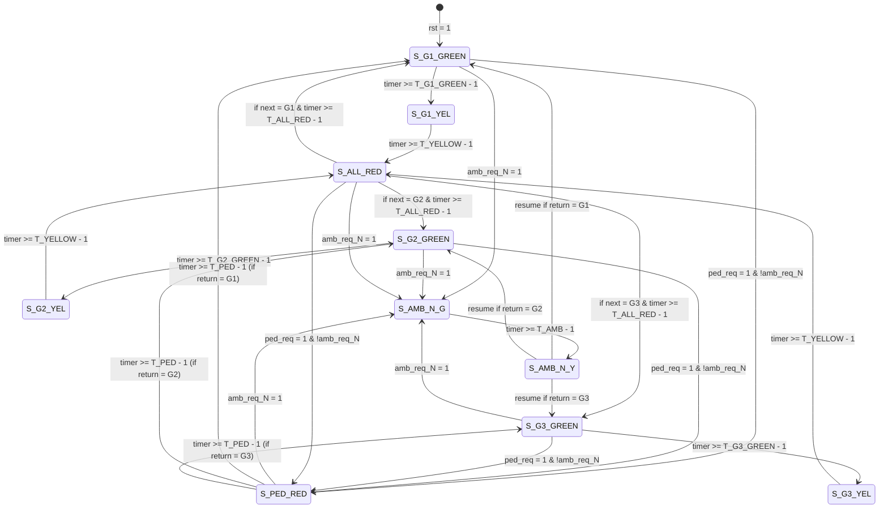

# Finite State Machine (FSM) Specification

## 1. FSM States

The controller defines 10 discrete states mapped onto a 4-bit state register:

| State Constant | Binary | Value | Description |
| :--- | :--- | :--- | :--- |
| `S_G1_GREEN` | `4'b0000` | `4'd0` | Group 1 (N, S, E, W) Green; all diagonals Red. |
| `S_G1_YEL`   | `4'b0001` | `4'd1` | Group 1 (N, S, E, W) Yellow; all diagonals Red. |
| `S_G2_GREEN` | `4'b0010` | `4'd2` | Group 2 (NW, SE) Green; all other directions Red. |
| `S_G2_YEL`   | `4'b0011` | `4'd3` | Group 2 (NW, SE) Yellow; all other directions Red. |
| `S_G3_GREEN` | `4'b0100` | `4'd4` | Group 3 (SW, NE) Green; all other directions Red. |
| `S_G3_YEL`   | `4'b0101` | `4'd5` | Group 3 (SW, NE) Yellow; all other directions Red. |
| `S_ALL_RED`  | `4'b0110` | `4'd6` | Inter-phase safety clearance; all 8 directions Red. |
| `S_PED_RED`  | `4'b0111` | `4'd7` | Pedestrian crossing priority; all 8 directions Red. |
| `S_AMB_N_G`  | `4'b1000` | `4'd8` | Ambulance emergency priority; North Green, all others Red. |
| `S_AMB_N_Y`  | `4'b1001` | `4'd9` | Ambulance clearance; North Yellow, all others Red. |

---

## 2. State Transition Diagram

---

## 3. Signal Output Truth Table

Light values: `G = GREEN (3'b001)`, `Y = YELLOW (3'b010)`, `R = RED (3'b100)`.

| State | North | South | East | West | NW | NE | SW | SE | Active Condition |
| :--- | :---: | :---: | :---: | :---: | :---: | :---: | :---: | :---: | :--- |
| `S_G1_GREEN` | **G** | **G** | **G** | **G** | R | R | R | R | Straight lanes moving |
| `S_G1_YEL`   | **Y** | **Y** | **Y** | **Y** | R | R | R | R | Straight lanes stopping |
| `S_G2_GREEN` | R | R | R | R | **G** | R | R | **G** | NW-SE diagonals moving |
| `S_G2_YEL`   | R | R | R | R | **Y** | R | R | **Y** | NW-SE diagonals stopping |
| `S_G3_GREEN` | R | R | R | R | R | **G** | **G** | R | SW-NE diagonals moving |
| `S_G3_YEL`   | R | R | R | R | R | **Y** | **Y** | R | SW-NE diagonals stopping |
| `S_ALL_RED`  | R | R | R | R | R | R | R | R | Intersection clear interval |
| `S_PED_RED`  | R | R | R | R | R | R | R | R | Pedestrians crossing |
| `S_AMB_N_G`  | **G** | R | R | R | R | R | R | R | North ambulance corridor |
| `S_AMB_N_Y`  | **Y** | R | R | R | R | R | R | R | North ambulance clearance |

---

## 4. Priority Resolution & Preemption Rules

1. **Ambulance Highest Precedence**:
   - `amb_req_N` has strict priority over all other states, including active pedestrian halts (`S_PED_RED`).
   - Forces immediate transition to `S_AMB_N_G` within exactly one clock cycle.
   - Saves the interrupted regular phase in `return_state`.
   - Before resuming normal traffic, traverses `S_AMB_N_Y` (yellow clearance) to prevent sudden broadside collisions.

2. **Pedestrian Safety Precedence**:
   - `ped_req` preempts normal vehicular green and yellow phases.
   - Transitions directly to `S_PED_RED`, holding all 8 vehicle signals at `RED` for $T_{\text{PED}}$ clock ticks.
   - Resumes seamlessly at the next scheduled green group upon timeout.
